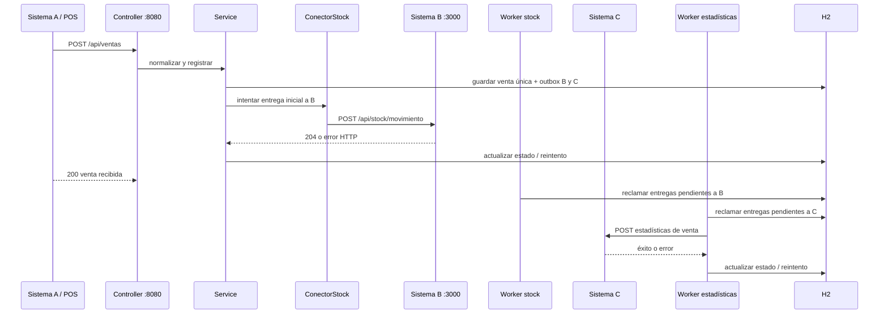

# Arquitectura

El repositorio contiene dos aplicaciones ejecutables y un tercer destino externo:

- **Integración**, puerto `8080`: recibe ventas de A y A2, las normaliza y coordina las entregas.
- **Sistema B ficticio**, puerto `3000`: simula el ERP, valida movimientos y actualiza inventario.
- **Sistema C**: destino externo para estadísticas. Su servicio no está incluido en el repositorio.

## Flujo

El endpoint manual `POST /api/movimientos` usa el mismo conector, pero genera fecha y referencia automáticamente. Está pensado para pruebas manuales; el POS debe seguir enviando el contrato completo a `/api/ventas`.

## Responsabilidades

| Componente | Función |
| --- | --- |
| Controladores | Recibir y validar HTTP; delegar la lógica. |
| Normalizadores | Convertir el contrato de A o A2 a una venta normalizada común. |
| Servicios | Guardar ventas únicas y coordinar el procesamiento de operaciones. |
| `ProcesadorOutboxStock` | Reclamar operaciones pendientes, enviar a B y programar reintentos. |
| `ProcesadorOutboxEstadisticas` | Enviar estadísticas a C desde una outbox independiente. |
| `ConectorEstadisticas` | Abstraer la comunicación con C, con implementación HTTP o simulada. |
| `MovimientoStockMapper` | Convertir la venta normalizada a una `SALIDA` para B. |
| `ConectorStock` | Desacoplar la integración de la implementación externa. |
| `ConectorStockSistemaB` | Enviar el movimiento mediante HTTP. |
| `ConectorStockSimulado` | Simular el envío en el perfil predeterminado. |
| `ServicioInventarioStock` | Aplicar entradas y salidas transaccionales. |

El mapper conserva fecha, código y cantidad; omite precio y cajero porque B no los necesita. Las ventas usan referencia `VENTA-{ventaId}`.

La integración persiste cada venta y sus operaciones para B y C antes de llamar a los destinos. La restricción única de `ventaId` deduplica solicitudes de A y A2; ante un ID repetido, se conserva la primera solicitud y se ignoran las siguientes. No se compara si el cuerpo repetido tiene productos distintos. Los errores transitorios se reintentan con demora exponencial; `GET /api/ventas/{ventaId}` permite consultar el estado y los intentos.

La misma transacción persiste una operación independiente para C. Su trabajador y estado no comparten la ejecución ni el resultado de B, por lo que la indisponibilidad de C no impide descontar stock. `cantidadProductos` es la suma de las unidades. `importeTotal` suma cantidad por precio unitario; si algún artículo no tiene precio (como ocurre con A2), se envía como `null`.

El Sistema B ficticio persiste las referencias procesadas y no vuelve a aplicar el stock cuando recibe una repetición idéntica. Reutilizar la referencia con otro contenido se rechaza con `409`. Esto protege contra el caso en que B aplicó el movimiento pero la respuesta HTTP se perdió.

La integración guarda ventas y la outbox en `integracion-stock.mv.db`, en el directorio desde donde se inicia la aplicación. La configuración de reintentos está en `src/main/resources/application.properties`; por defecto se permiten cinco intentos, con demora exponencial desde cinco segundos hasta cinco minutos.

## Conectores y datos

Sin perfiles externos activos se usan conectores simulados. Para comunicar con B y C, iniciar con los perfiles `sistema-b,sistema-c`; URL y API key de B y URL/ruta de C se configuran en `application.properties`. C es un sistema externo: debe estar disponible en la dirección configurada; el repositorio no incluye un simulador local de C.

El catálogo no tiene productos precargados. Se registra cada código explícitamente y las compras ingresan como `ENTRADA`; las ventas salen como `SALIDA`. H2 guarda catálogo, saldo y referencias procesadas en `fake-sistema-b/sistema-b.mv.db`, por lo que sobreviven al reinicio. El endpoint de historial de movimientos es temporal y se reinicia con el simulador; no es el registro de idempotencia. El simulador no reemplaza un ERP real.